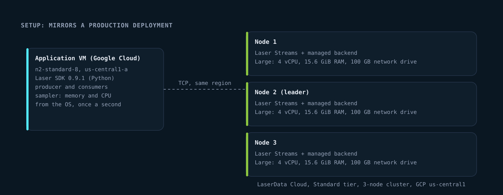
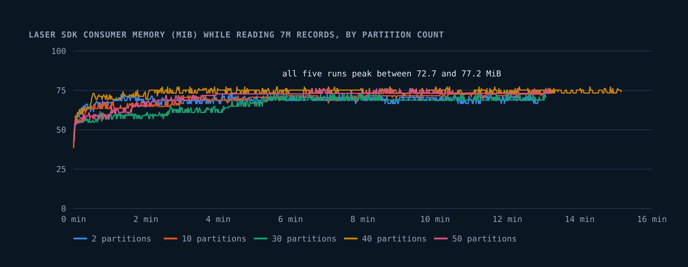
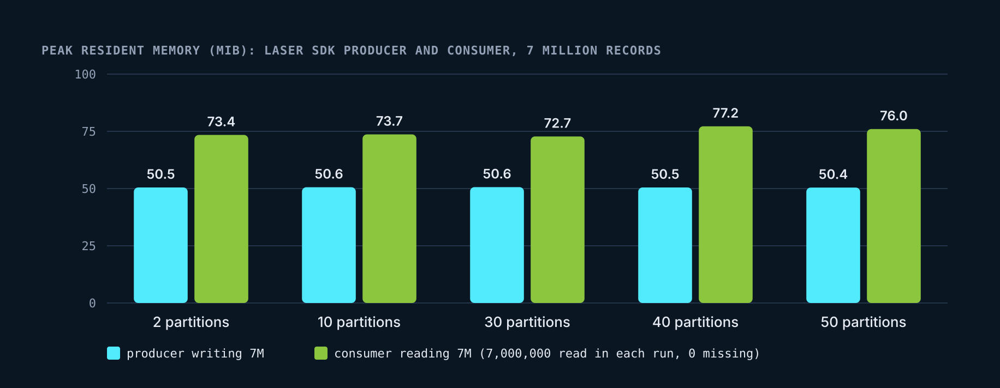
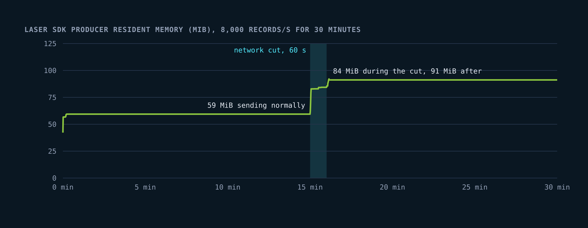
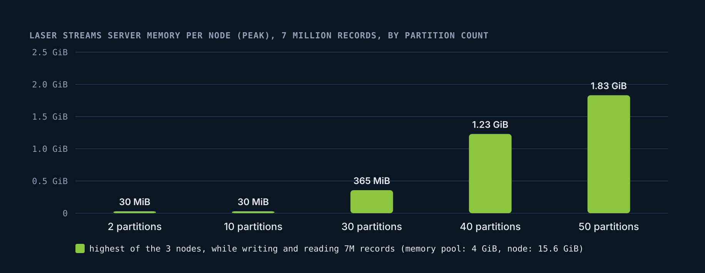
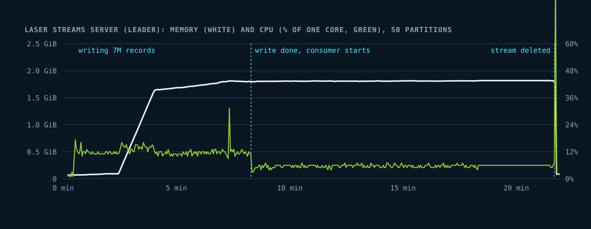
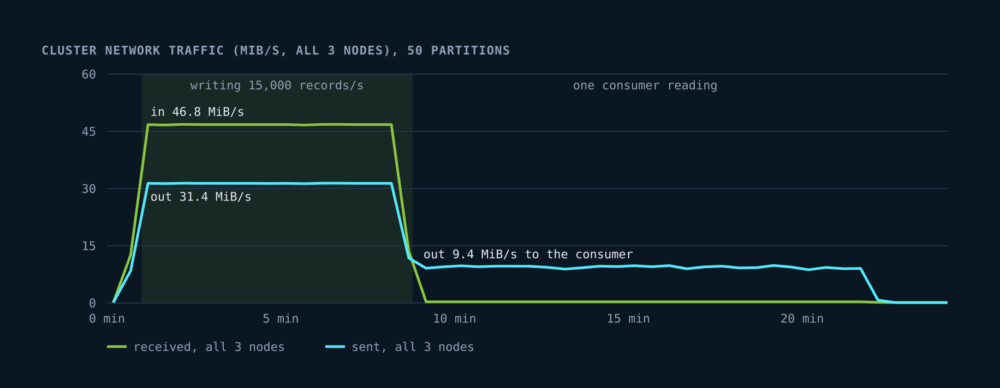
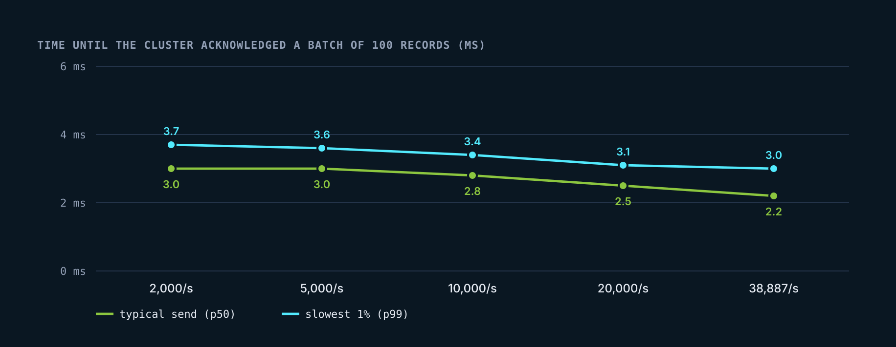

# How LaserData keeps streaming memory steady under a 7M-record load

> `use-cases` repo next to [`bounded-memory-under-pressure`](../bounded-memory-under-pressure).

LaserData analysed 800+ public issues from other open-source streaming projects, where consumers and producers take gigabytes of memory during backlogs and outages. On LaserData Cloud, memory stayed steady and bounded under a 7M-record load.

> **LaserData kept memory low while streaming 7 million records: at most 77.2 MiB for a consumer reading the backlog, 92 MiB for a producer through a network outage, and 544 MiB for a server after a restart.** That is a small fraction of the 6 GB, 8 GB and 5 GiB that public issues from other open-source streaming projects report for the same situations.


*Memory reported in individual public GitHub issues, each measured on that team's own setup and workload, shown alongside the peaks measured on LaserData in the tests below.*

## The problem: memory during backlogs, outages and restarts

LaserData analysed 747 GitHub issues, 77 Stack Overflow questions and 179 Hacker News comments about memory and CPU in other open-source streaming projects. The three most common problems found were:

- **A consumer that falls behind holds the backlog in memory.** The more partitions and the further behind it is, the more memory it uses, until it is killed for running out of memory. Reports describe consumers going from 800 MB to 6 GB.
- **A producer holds every unsent record in memory while the cluster is unreachable.** Under sustained sends, its buffers fill, and the memory is not released afterwards. The usual workaround is shrinking buffers by hand, at the risk of losing records.
- **A restarting server takes several cores and gigabytes of memory.** While a server reloads its data after a restart, the services running next to it slow down until it finishes, and clients see errors or pauses.

## Results at a glance

> **Steady memory on a production cluster.** These results come from streaming 7 million records through a replicated 3-node LaserData Cloud cluster with Large nodes, set up the way teams run it in production.


*The headline numbers from the tests below, on LaserData Cloud.*

## How we measured

The setup mirrors a production deployment. The cluster was a LaserData Cloud Standard deployment on Google Cloud (us-central1) with three Large nodes, 4 vCPU and 15.6 GiB RAM each. Every node runs the Laser Streams server and LaserData's managed backend on a 100 GB network drive, and every record is replicated to all three. The application ran on its own Google Cloud VM in the same region, the way a production application reaches its streaming cluster.



*An application VM streaming to a replicated cluster in the same region, as in production. On the application VM, a small sampler reads each process's memory and CPU from the operating system once a second. Server memory, CPU, disk, network and replication health per node come from the LaserData Cloud console.*

How each run was set up and checked:

- **Production settings.** The cluster ran as deployed, with a 4 GiB memory pool, no partition cap and no rate limit. The clients used the standard Laser SDK settings. Records were 1 KiB, sent in batches of 100, as in LaserData's own benchmark suite.
- **A safe rate first.** Before the memory tests, one producer ramped up to 40,000 records/s (section 5). We then paced the backlog writes at 15,000 records/s and the producer test at 8,000 records/s. These rates are test settings, not throughput limits.
- **Every record checked.** Each record carries a number, and the consumer checks that every number arrives exactly once. Any record lost without an error to the producer fails the run.

## 1. A consumer reading a 7-million-record backlog, on 2 to 50 partitions

We wrote 7 million records to a topic, then started one Laser SDK consumer to read them all from the start, on 2, 10, 30, 40 and 50 partitions.



*Resident memory of the consumer from its start until it had read all 7 million records, one line per partition count. Memory stayed steady and bounded at every partition count.*

**Consumer memory stayed flat at every partition count.** It held between 72.7 and 77.2 MiB from 2 to 50 partitions. The Laser SDK bounds each fetch, not each partition: a poll returns at most `batch_length` records and `max_bytes` of data, regardless of how many partitions the consumer group spans or how large the lag is. More partitions add offsets to track, not buffered data.



*Peak memory of the producer that wrote each backlog and of the consumer that read it, per partition count.*

**Producer memory stayed at about 50 MiB at every partition count.** Writing each 7-million-record backlog at 15,000 records/s, the producer peaked at 50.4–50.6 MiB and used about 11% of one core, from 2 to 50 partitions.

**No missing or duplicate records.** Across the five runs, the consumer read 35 million records, with none missing and none duplicated.

## 2. A graceful restart while a consumer reads a 7M-record backlog

We triggered a rolling restart of the Laser Streams server, which restarts one node at a time while the cluster continues serving. Two nodes, including the leader, restarted during the 40-partition backlog test, while the consumer was reading the 7 million records.


**Zero records lost during the restart.** Two nodes restarted and leadership moved from node 2 to node 3, while the consumer reconnected automatically and received all 7,000,000 records, with none missing or duplicated.

**No memory or CPU spike on restart.** In the first minute after rejoining, each restarted node peaked at 544 MiB and 40% of one core while reopening its data from disk, below the 1.2 GiB it held before the restart.

**Lower memory after restart.** Both restarted nodes dropped from about 1.2 GiB to about 520 MiB and continued serving the same data from disk.

## 3. Producer memory stays capped through a 60-second network outage

One Laser SDK producer in background (buffered) mode sent 8,000 records per second for 30 minutes to a 12-partition topic, with the SDK's standard buffer budget, while six consumers read the same topic and checked every record. Halfway through, we cut the network between the application VM and the cluster for 60 seconds, dropping every connection, to simulate a network partition.



*Producer resident memory over the run: flat during normal sending, rising while the cluster is unreachable and the buffer fills to its budget, then level for the rest of the run.*

**Producer memory is capped by a configurable budget.** In background mode the Laser SDK keeps unsent records in a buffer with a byte budget (`max_buffer_size`). When the budget is full, `failure_mode` decides what a send does: `block` waits, `block_with_timeout` waits up to a limit, and `fail_immediately` raises an error. The network cut therefore slowed the producer down instead of growing its memory: it fell about a minute behind, then caught up and sustained 8,000 records/s until the end.

**Memory plateaus after the outage.** It rose from 59 MiB to 84 MiB during the cut, then plateaued near 91 MiB (92 MiB peak) for the last 14 minutes. When the buffer drains, the allocator retains those pages for the next burst rather than returning them to the operating system immediately, so memory settles near the size of the last burst. This is a ceiling, not a leak; a smaller `max_buffer_size` lowers it.

**No silent failures.** Every one of the 14.4 million records was either delivered exactly once or reported to the application. The 1,100 records in flight when the network went down were reported through the SDK's error callback, so the application can re-send them.

## 4. Server memory, CPU and network during the backlog tests

LaserData Cloud reports memory, CPU, disk, network and replication health for each node. We recorded them every few seconds through all five backlog runs, from before the first record was written until after the stream was deleted.



*Peak memory of the Laser Streams server on the busiest node in each backlog run.*

**Server memory scales with partition count, not backlog size.** Every run held the same 7 million records. At 2 and 10 partitions, the server stayed at about 30 MiB per node throughout. At 30, 40 and 50 partitions, it rose once the backlog passed about 1.5 million records, then plateaued at 365 MiB, 1.23 GiB and 1.83 GiB per node. In every run it stayed well within the 4 GiB memory pool and the node's 15.6 GiB.



*Memory and CPU of the Laser Streams server on the leader node through the 50-partition backlog test. The two followers tracked the leader within a few MiB. The short CPU burst at the end is the stream being deleted.*

**Reads added no server memory.** Once server memory plateaued, it stayed flat for the 13 minutes the consumer took to read all 7 million records.

**Low server CPU.** Writing 15,000 records/s used about 12% of one core per node, and serving reads used 5 to 6%, on 4-vCPU nodes.

**Memory and disk released on stream deletion.** When the stream was deleted, server memory on each node dropped below 90 MiB and disk usage returned to its earlier level. While holding the data, each node used 1.06 to 1.07 × the record size on disk, including indexes.



*Network traffic summed over the three nodes during the 50-partition backlog test.*

**Replication traffic tracked the write rate.** Writing 15,000 records/s is 14.6 MiB/s of data. The cluster received 46.8 MiB/s in total, about three times that: the leader receives each batch from the client, and each follower receives a copy from the leader. It sent 31.4 MiB/s, about twice the data, for the two copies. While the consumer read the backlog, the cluster sent 9.4 MiB/s, matching the consumer's read rate.

## 5. Send latency and throughput across a 20× rate increase

One Laser SDK producer sent to a 10-partition topic at 2,000, 5,000, 10,000, 20,000 and 40,000 records/s, two minutes per step, and timed every batch from send until the cluster acknowledged it.

**Every rate step sustained, with zero errors.** The producer reached 38,887 records/s at the top step (about 38 MiB/s of 1 KiB records into a replicated cluster) from a single Python process.

> **Send latency held at about 3 ms across a 20× rate increase.** The median batch was acknowledged in 2.2 to 3.0 ms and the p99 in at most 3.7 ms, at every rate. Producer memory stayed between 48.9 and 54.3 MiB throughout.



*Time from sending a batch of 100 records until the cluster acknowledged it, measured in the client, at each step.*

## Why memory stays steady and within its limit on LaserData

> - **No heap sizing, no garbage collector.** Laser Streams and the Laser SDK core are written in Rust. Memory is freed deterministically when no longer used, so there is no heap to pre-size and no garbage collector requiring headroom or causing pauses.
> - **Explicit memory budgets.** The server's buffers come from a memory pool with a fixed budget (`memory_pool.size`, 4 GiB in these tests), filled on demand. On the client, fetches and send buffers have byte limits.
> - **One shard per core.** Each core owns its partitions exclusively, so additional partitions add bookkeeping, not threads or buffers.

## Run it yourself

You need a LaserData Cloud deployment (Standard tier or higher) with an access rule for your client's IP, and a Google Cloud project for the client VM.

```bash
echo "LASER_CONNECTION_STRING='<your connection string>'" > ~/cluster.env
export PROJECT=your-gcp-project ZONE=us-central1-a CLUSTER_ENV=~/cluster.env
cloud/one-vm.sh up                                   # client VM next to your cluster
cloud/one-vm.sh run ramp                             # send time and throughput, step by step
SCALE_RATE=15000 cloud/one-vm.sh run backlog-50      # 7M-record backlog: backlog-2, -10, -30, -40 or -50
SCALE_RATE=8000 cloud/one-vm.sh run producer         # 30 min, 60 s network cut
cloud/one-vm.sh run restart                          # live producer + consumer; restart Iggy in the console
cloud/one-vm.sh down                                 # delete the VM
```

For `restart`, once the run prints "ready", restart the server in the console, then on the VM touch `$FOOTPRINT_OUT/restart_clicked`, and `$FOOTPRINT_OUT/restart_finished` once all nodes serve again.

To record the server's per-node metrics while a test runs, open your deployment's Monitor page and run `cloud/console_recorder.js` in that tab, as its header explains.

The raw per-second samples, the per-node server metrics and the run logs are in the results folders: [backlog tests and restart](results/cloud-large-3node-rerun) and [ramp-up and producer test](results/cloud-large-3node). If you run it on your own cluster, share your results (node size, partition count and region) in the [use-cases repo](https://github.com/laserdata/use-cases/issues).

## Files

| Path | What it is |
|---|---|
| `footprint/backlog.py`, `restart.py`, `producer_outage.py`, `ramp.py`, `smoke.py` | the tests (Laser SDK 0.9.1, Python) |
| `footprint/common.py`, `sampler.py` | shared helpers and the once-a-second memory and CPU sampler |
| `run.sh` | runs one test on the application VM and writes `env.json`, `samples.csv`, `events.jsonl` |
| `cloud/one-vm.sh` | creates the application VM, runs a test, fetches results, deletes the VM |
| `cloud/console_recorder.js` | records the console's per-node server metrics during a test |
| `cloud/charts.py`, `charts_template.html` | interactive results page built from the results |
| `cloud/blog_figures.py` | the blog's charts (SVG) and `numbers.json`, from the results folders |
| `results/cloud-large-3node-rerun/` | backlog at 2–50 partitions with server metrics, and the restart; `figures/` holds the blog's charts and the numbers they show |
| `results/cloud-large-3node/` | send latency ramp-up and producer outage |
