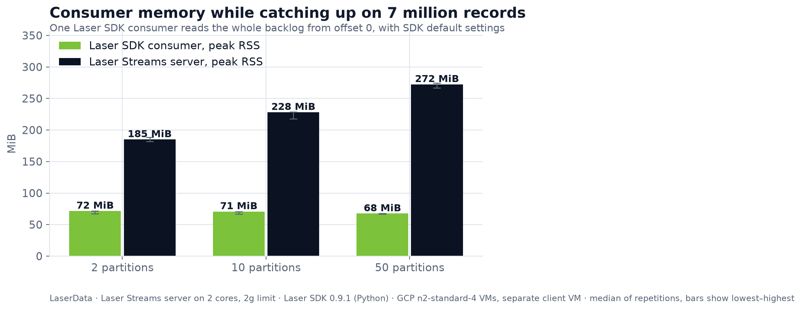
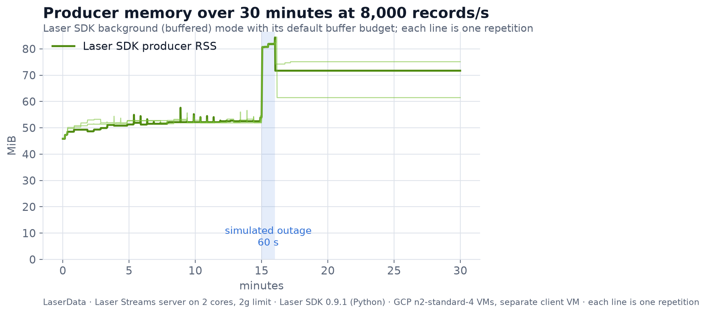
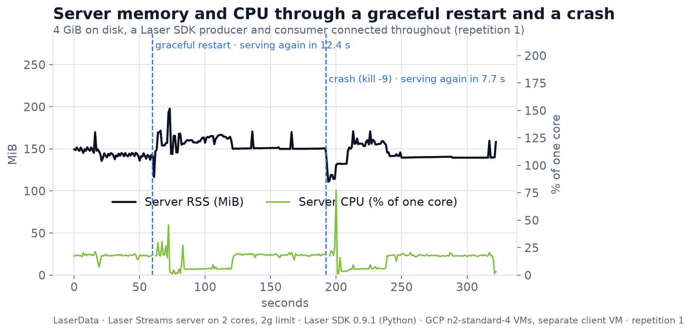

# Bounded memory under pressure

Three tests that measure the memory and CPU of LaserData's server (Laser Streams) and of Laser SDK
clients in the situations engineers report most. Measured self-hosted on Google Cloud VMs, 3
repetitions. You can also run them against your own deployment on
[LaserData Cloud](https://laserdata.cloud).

## The problems

| Test | The problem it answers | What runs | Pass condition |
|---|---|---|---|
| `consumer_backlog.py` | A consumer that grows from 800 MB to 6 GB when partitions and lag go up | 7 million records (1 KiB) preloaded at 2, 10 and 50 partitions; one Laser SDK consumer reads them all from offset 0 | every record read once |
| `producer_pause.py` | A producer whose memory keeps climbing under sustained sends | Laser SDK producer, background mode, 8,000 records/s for 30 minutes; server made unreachable for 60 s halfway (its container paused with `docker pause`); a consumer checks every record | no record missing unless the SDK reported it to the app |
| `restart.py` | A broker restart that spikes CPU and memory and stalls its neighbours | 4 GiB on disk; producer (5,000 records/s) and consumer connected; graceful restart, then `kill -9` and start | no confirmed record missing |

## Results (Google Cloud, median of 3)

| Test | Result |
|---|---|
| Consumer, 7 million record backlog | Consumer peak 68–72 MiB at 2, 10 and 50 partitions; every record read once |
| Producer, 30 minutes with a 60 s outage | 52 MiB while sending, 84 MiB peak after the outage, no growth after it; every missing record was reported to the app |
| Server restart, 4 GiB on disk | Serving again in 12 s (graceful) and 8 s (crash); server memory peak 238 MiB; no confirmed record missing |

Full tables with the lowest and highest of the three runs: [gcp-vm/results/sized-2g](gcp-vm/results/sized-2g/README.md).





## How it measures

- **Where:** for each test, one **server VM** running Laser Stack and one **client VM** running the
  Laser SDK tests against it over the zone's internal network, the way an app reaches its streaming
  server. All tests run at once.

  | | Server VM | Client VM |
  |---|---|---|
  | Machine | `n2-standard-4`: 4 dedicated vCPU, 16 GB | `n2-standard-4` |
  | Disk | 100 GB SSD persistent disk, normal mount (write barriers) | boot disk |
  | Runs | Laser Stack, server on 2 cores with a 2 GiB limit, own sampler | Laser SDK tests, client sampler, `docker pause/restart` on the server over SSH |

- **Server:** Laser Streams and LaserData's managed backend, started with
  [Laser Stack](https://github.com/laserdata/laser-stack)'s own `scripts/up` at a pinned commit.
  `stack/limits.yml` gives the server two dedicated cores and a 2 GiB memory limit.
  `stack/sized-2g.yml` sets the memory pool to 512 MiB and the write-ahead log to its minimum
  (~128 MiB per partition), sized for a 2 GiB node.
  Laser Stack's shipped values are meant for larger nodes.
- **Clients:** [Laser SDK](https://docs.laserdata.com/laser-sdk) for Python, SDK default settings.
  Record size (1 KiB) and batch size (100) are taken from LaserData's own benchmark suite.
- **Numbers:** `footprint/sampler.py` reads every process's resident memory and CPU from `/proc`
  and cgroup v2 once a second. The container total (which includes page cache) is recorded too.
- **Correctness:** every record carries a sequence number; missing or duplicate records are counted.

## Run it

**On Google Cloud, one command from your laptop** (needs `gcloud` signed in to a project where you
can create VMs):

```bash
PROJECT=my-project gcp-vm/run-gcp.sh                       # all five tests, one repetition
PROJECT=my-project FOOTPRINT_SCALE=0.1 gcp-vm/run-gcp.sh   # quick trial, about 20 minutes
PROJECT=my-project TESTS="restart" gcp-vm/run-gcp.sh       # one test: backlog-2, backlog-10, backlog-50, producer, restart
PROJECT=my-project ZONE=us-central1-a gcp-vm/run-gcp.sh    # another zone
```

It creates a server VM and a client VM per test, runs everything at once, brings the evidence back
to `gcp-vm/results/sized-2g/incoming/` and deletes every VM it created, when it finishes or fails.
Cost: two `n2-standard-4` VMs per test for about 45 minutes, roughly $0.20 per test in
`asia-south1`. Then build the tables and charts:

```bash
python footprint/merge.py gcp-vm/results/sized-2g/incoming gcp-vm/results/sized-2g
python footprint/summarize.py gcp-vm/results/sized-2g && python footprint/charts.py gcp-vm/results/sized-2g
```

**On LaserData Cloud:** you can also run these tests against your own
[LaserData Cloud](https://laserdata.cloud) deployment. This needs a paid tier (Standard or higher).

**With a coding agent:** in Claude Code, the `bounded-memory-under-pressure` skill in
`.claude/skills/` walks through a run step by step. Other agents: see `AGENTS.md`.

## Good to know

- LaserData's managed backend keeps its data only on disks with write barriers. The Google Cloud
  script gives the server VM an SSD persistent disk for its data (`stack/data-disk.yml`).
- The test consumer is one Python process handling one record at a time, so it reads roughly
  8,000–13,000 records/s. That is the test client's pace, so the results make no throughput claims.
- A long-running service should rebuild its consumer if the live stream ends after a long outage;
  it resumes from the group's stored offset. The tests do this and record how often it happened.

## Files

| File | Purpose |
|---|---|
| `gcp-vm/run-gcp.sh` | One command: create VMs, run, collect, delete |
| `gcp-vm/setup-vm.sh`, `server-up.sh`, `collect.py` | VM setup, starting the server, gathering evidence |
| `gcp-vm/results/sized-2g/` | Published results: tables, `summary.json`, charts, raw evidence per repetition |
| `run.sh` | Runs the tests on the client VM against the server VM |
| `stack/limits.yml` | Cores and memory limit for the server |
| `stack/sized-2g.yml` | Server memory settings for a 2 GiB node |
| `stack/data-disk.yml` | Server data on a disk with write barriers |
| `footprint/consumer_backlog.py`, `producer_pause.py`, `restart.py` | The three tests |
| `footprint/sampler.py` | Per-second memory and CPU from the kernel |
| `footprint/merge.py`, `summarize.py`, `charts.py` | Build the results tables, `summary.json` and the charts |
| `AGENTS.md`, `.claude/skills/bounded-memory-under-pressure/` | Guidance for coding agents |

Built by the LaserData team.
